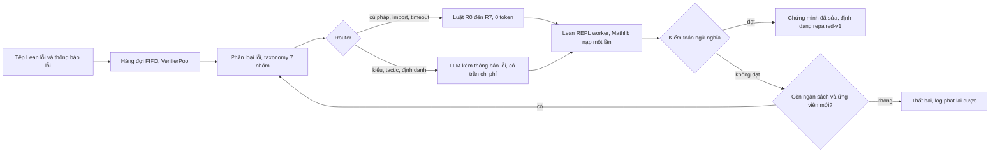

# Nhóm 6: Verifier-Guided Repair, sửa chứng minh Lean 4 có kiểm chứng

Bài tập lớn môn **INT4418 Dữ liệu lớn**, chương trình Thạc sĩ, Học viện Công nghệ Bưu chính Viễn thông. Giảng viên hướng dẫn: **TS. Nguyễn Kiều Linh**. Phiên bản nộp bài: tag [`v1.0`](https://github.com/tamdv/ai4math-verifier-guided-repair/tree/v1.0).

Hệ thống nhận các tệp Lean 4 không biên dịch được, phân loại lỗi từ thông báo thật của Lean, sửa bằng luật không tốn token hoặc bằng LLM có kèm thông báo lỗi, rồi chỉ chấp nhận bản sửa khi Lean biên dịch được và bộ kiểm toán xác nhận đề bài không bị thay đổi. Toàn bộ chạy trong một vòng lặp có giới hạn số lần thử, thời gian và chi phí, trên một pool worker Lean REPL thường trú.

## Tài liệu nộp

| Tài liệu | Tệp |
|---|---|
| Báo cáo, 19 trang | [PDF](reports/report.pdf) · [DOCX](reports/report.docx) · [nguồn Markdown](reports/report.md) |
| Slide thuyết trình, 15 trang và 2 trang phụ lục | [PDF](slides/Slides_Nhom6_VerifierRepair.pdf) · [PPTX](slides/Slides_Nhom6_VerifierRepair.pptx) |
| Kịch bản demo | [slides/demo_script.md](slides/demo_script.md) |
| Bộ câu hỏi vấn đáp | [slides/defense_qa.md](slides/defense_qa.md) |
| Phân công và đóng góp | [contributions.md](contributions.md) |
| Khai báo sử dụng AI | [docs/ai_use_statement.md](docs/ai_use_statement.md) |

## Kết quả chính

Thực nghiệm chạy trên Kaggle CPU với 4 vCPU và 31 GB RAM, dùng Lean 4.35 và Mathlib v4.35, trên tập 17.031 lỗi có nhãn sinh từ Lean.

| Câu hỏi | Kết quả |
|---|---|
| **RQ1:** thông báo lỗi có cấu trúc so với thử lại nguyên prompt, 284 mẫu hold-out, 3 lần lặp | Tỷ lệ sửa thành công đã kiểm toán tăng từ **31,7%** lên **53,9%**, chi phí giảm 45% |
| **RQ2:** chiến lược định tuyến và ngân sách thử lại | LLM có thông báo lỗi với 3 lần thử đạt **65,1%** ở 2,45 USD cho 1.000 mẫu; chỉ dùng luật đạt 23,9% với 0 USD |
| **RQ3:** khả năng mở rộng 100, 1.000, 10.000 mẫu với 1, 2, 4 worker, 3 lần lặp | Ở mức 10.000: 1,52, 2,68 và 2,86 mẫu mỗi giây. Tăng tốc 1,76 lần với 2 worker nhưng chỉ 1,88 lần với 4 worker vì nghẽn CPU |
| Kiểm chứng Lean: chạy nguội so với REPL thường trú | Từ 63 đến 107 giây mỗi tệp xuống 3 ms ở P50 và 23 ms ở P95 mỗi định lý |
| Tổng chi phí API | **2,97 USD**, ghi trong [results/cost_ledger.jsonl](results/cost_ledger.jsonl) |

| Ablation trên hold-out 1K | Chi phí và chất lượng | Mở rộng theo số worker |
|---|---|---|
|  |  |  |

Toàn bộ bảng số liệu nằm trong [results/figures/](results/figures/), sinh bằng script từ 48 run record trong [results/raw/](results/raw/).

## Kiến trúc



| Thành phần | Mã nguồn |
|---|---|
| Kiểm chứng: Lean nguội, REPL thường trú, pool worker | [src/lean_verifier.py](src/lean_verifier.py), [src/lean_repl.py](src/lean_repl.py), [src/verifier_pool.py](src/verifier_pool.py) |
| Phân loại lỗi và taxonomy v0.2 | [src/error_parser.py](src/error_parser.py), [docs/error_taxonomy_v0.2.md](docs/error_taxonomy_v0.2.md) |
| Luật sửa R0 đến R7 | [src/rule_repair.py](src/rule_repair.py) |
| Sửa bằng LLM, client và kiểm soát chi phí | [src/llm_repair.py](src/llm_repair.py), [src/llm_client.py](src/llm_client.py), [src/cost_guard.py](src/cost_guard.py) |
| Vòng lặp có giới hạn và kiểm toán | [src/repair_pipeline.py](src/repair_pipeline.py), [src/semantic_auditor.py](src/semantic_auditor.py) |
| Sinh dữ liệu lỗi | [src/mutations.py](src/mutations.py), [scripts/build_seeds.py](scripts/build_seeds.py), [scripts/generate_error_dataset.py](scripts/generate_error_dataset.py) |
| Thực nghiệm, hình, phân tích lỗi | [scripts/run_experiment.py](scripts/run_experiment.py), [scripts/generate_figures.py](scripts/generate_figures.py), [scripts/analyze_failures.py](scripts/analyze_failures.py) |
| Ghi provenance cho mỗi lần chạy | [src/provenance.py](src/provenance.py) |

## Cấu trúc thư mục

```text
src/              pipeline: kiểm chứng, phân loại, luật, LLM, vòng lặp, kiểm toán, chi phí
tests/            96 unit test, không cần Lean hay API
scripts/          dữ liệu, thực nghiệm, hình, phân tích, demo, xuất kết quả, dựng báo cáo
configs/          prompt, trần chi phí, giá LLM, kế hoạch thí nghiệm
notebooks/        notebook Kaggle, thư mục sessions/ có sẵn cấu hình từng phiên
lean_ws/          Lake workspace ghim Lean, Mathlib và REPL v4.35.0
data_sample/      mẫu dữ liệu nhỏ trong Git và manifest.json ghi checksum dữ liệu đầy đủ
results/raw/      run record run_<id>.json và log logs/<id>.jsonl.gz phát lại được
results/figures/  hình và bảng sinh từ results/raw
docs/             data card, system card, taxonomy, đặc tả đầu vào và đầu ra, giấy phép, AI-use
reports/          báo cáo: nguồn Markdown, template PTIT, DOCX, PDF
slides/           slide, kịch bản demo, câu hỏi vấn đáp
```

## Cài đặt

```bash
python3 -m venv .venv && source .venv/bin/activate
pip install -r requirements-lock.txt
python -m pytest tests -q
```

Chạy Lean trên máy cần ít nhất 16 GB RAM còn trống cho 1 đến 2 worker, vì máy 16 GB đang mở nhiều ứng dụng sẽ swap nặng:

```bash
curl -sSf https://raw.githubusercontent.com/leanprover/elan/master/elan-init.sh | sh -s -- -y --default-toolchain none
cd lean_ws && lake exe cache get && lake build repl && cd ..
```

Hoặc dùng Docker; image đã build thử trên linux/arm64, nặng 16,6 GB, chạy được toàn bộ test và cổng Nhóm 5 với Lean thật:

```bash
docker build -t g6-verifier-repair .
docker run --rm --init g6-verifier-repair
docker run --rm --init g6-verifier-repair python scripts/repair_batch.py \
    --input data_sample/group5_input_sample.jsonl --strategy rule_only --budget 3 --workers 1
```

Để dùng LLM, tạo tệp `.env` chứa `GEMINI_API_KEY=...`; tệp này đã nằm trong `.gitignore`. Trần chi phí đặt trong [configs/budget.yaml](configs/budget.yaml).

## Demo

Luồng demo: lỗi, phân loại, sửa, Lean kiểm tra, kiểm toán. Chế độ phát lại đọc log thực nghiệm nên không cần Lean, mạng hay chi phí:

```bash
python scripts/demo_repair.py --replay results/raw/logs/exp-llm_only-b3-w4-20261017101714-3f7a7e.jsonl.gz \
    --error-id E000003 --data data/errors/errors_1k.jsonl
```

Kịch bản đầy đủ với 3 cảnh demo: [slides/demo_script.md](slides/demo_script.md).

## Tái lập kết quả

Dữ liệu, với checksum ghi trong [data_sample/manifest.json](data_sample/manifest.json):

```bash
bash scripts/download_data.sh
python scripts/build_seeds.py --n 5000 --workers 4 --timeout 30
python scripts/generate_error_dataset.py --workers 4 --max-per-seed 5 --timeout 30
```

Thực nghiệm chạy trên Kaggle: import một notebook trong `notebooks/sessions/`, gắn dataset lỗi làm Input, bật Internet, rồi chọn Save and Run All.

| Notebook | Nội dung | Chi phí |
|---|---|---|
| `run3b_scale_100_1k.ipynb` | Mở rộng ở mức 100 và 1.000 với 1, 2, 4 worker, 3 lần lặp | 0 USD |
| `run3a_scale_10k.ipynb` | Mở rộng ở mức 10.000 với 1, 2, 4 worker, 3 lần lặp | 0 USD |
| `run2b_llm_PAID.ipynb` | RQ1, RQ2, hold-out 10K và mô hình so sánh; cần Secret `GEMINI_API_KEY` | khoảng 3 USD |

Hình, bảng, phân tích lỗi, đầu ra bàn giao và báo cáo:

```bash
python scripts/generate_figures.py --input results/raw/ --output results/figures/
python scripts/analyze_failures.py --input results/raw/ --output results/figures/
python scripts/parser_ablation.py --verify
python scripts/export_repaired.py --run-id exp-llm_only-b3-w4-20261017101714-3f7a7e --data data/errors/errors_1k.jsonl
python scripts/build_report_docx.py && ./reports/to_pdf.sh
python slides/build_slides.py && ./slides/to_pdf.sh
```

Mỗi lần chạy ghi một run record gồm commit, phiên bản dữ liệu kèm checksum, máy, phần mềm, tham số, seed, timeout, chỉ số, trạng thái, cùng log từng mẫu để phát lại.

## Nhận dữ liệu từ Nhóm 5

Nhóm 5 gửi một file JSONL hoặc Parquet theo data contract v0.1; Nhóm 6 biên dịch lại từng ứng viên, sửa các ứng viên lỗi và trả về `feedback_group5.jsonl` cùng repaired-v1. Chạy thử trên file mẫu, chỉ dùng luật nên không tốn tiền:

```bash
python scripts/repair_batch.py --input data_sample/group5_input_sample.jsonl --strategy rule_only --budget 3 --workers 1
```

Hướng dẫn cho Nhóm 5: [docs/group5_handover_guide.md](docs/group5_handover_guide.md).

## Tài liệu kỹ thuật

| Tài liệu | Nội dung |
|---|---|
| [docs/data_card_lean_errors.md](docs/data_card_lean_errors.md) | Dataset lỗi v1.0: nguồn, giấy phép, các trường, cách chia tập, hạn chế |
| [docs/system_card.md](docs/system_card.md) | Hệ thống, rủi ro và biện pháp, hạn chế |
| [docs/error_taxonomy_v0.2.md](docs/error_taxonomy_v0.2.md) | 7 nhóm lỗi, dấu hiệu thật của Lean 4.35, định tuyến |
| [docs/data_contract_group5_group6.md](docs/data_contract_group5_group6.md) | Đầu vào từ Nhóm 5 |
| [docs/group5_handover_guide.md](docs/group5_handover_guide.md) | Nhóm 5 gửi gì, nhận lại gì, lệnh chạy cổng nhận |
| [docs/output_contract_group6.md](docs/output_contract_group6.md) | Đầu ra repaired-v1 cho Nhóm 7 và Nhóm 8 |
| [docs/license_privacy_note.md](docs/license_privacy_note.md) | Giấy phép và quyền riêng tư |

## Thành viên

| STT | Mã học viên | Họ và tên | Vai trò chính | Vai trò dự phòng |
|:---:|:---:|:---|:---|:---|
| 1 | B25CHHT112 | **Đào Văn Tâm**, trưởng nhóm | Evaluation và Cost Analysis | Queue và Worker System |
| 2 | B25CHHT088 | Trần Quang Đức Dũng | Queue và Worker System | Evaluation và Cost Analysis |
| 3 | B25CHHT117 | Lâm Thành Trung | Rule-based Repair | LLM Repair Engine |
| 4 | B25CHHT119 | Nguyễn Xuân Tùng | LLM Repair Engine | Rule-based Repair |
| 5 | B25CHHT125 | Khamsing OUTHAIHUENG | Parser và Taxonomy | Error Dataset và Contract |
| 6 | B25CHHT124 | Mekdala Nounou | Error Dataset và Contract | Parser và Taxonomy |

Chi tiết đóng góp và phần bảo vệ của từng thành viên: [contributions.md](contributions.md). Quy ước code và commit: [CONVENTIONS.md](CONVENTIONS.md).
