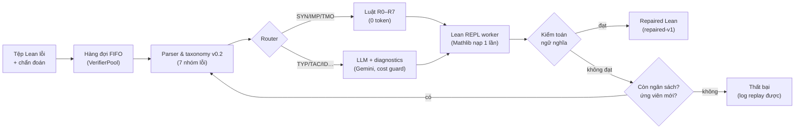

# Nhóm 6 — Verifier-Guided Repair: sửa chứng minh Lean 4 có kiểm chứng

Bài tập lớn **INT4418 – Dữ liệu lớn (Thạc sĩ), PTIT** · Giảng viên: **TS. Nguyễn Kiều Linh** · 2026

Hệ thống nhận tệp Lean 4 không biên dịch được, **phân loại lỗi từ chẩn đoán thật của Lean**, sửa bằng **luật (0 token) hoặc LLM có tiêm thông báo lỗi**, và chỉ chấp nhận bản sửa khi **Lean biên dịch được và kiểm toán ngữ nghĩa xác nhận đề không bị đổi** — trong một vòng lặp có giới hạn số lần thử, thời gian và chi phí, chạy trên pool worker Lean REPL thường trú.

## Kết quả chính (dataset v1.0, Kaggle CPU 4 vCPU / 31 GB)

| | Kết quả |
|---|---|
| **RQ1** — thông báo lỗi có cấu trúc vs thử lại mù (1K hold-out, n=284, 3 lần lặp) | **53,9%** vs **31,7%** sửa thành công đã kiểm toán (+22 điểm %), rẻ hơn ~45% token |
| **RQ2** — ngân sách thử lại / định tuyến | LLM+diagnostics k=3: **65,1%**; hybrid k=3: 59,5%; rule-only k=3: 23,9% |
| **RQ3** — khả năng mở rộng (100 → 1K → 10K × 1/2/4 worker × 3 lần lặp) | 10K: 1,52 → 2,68 → 2,86 mẫu/s (tăng tốc 1,76× / 1,88×); nút thắt CPU ở 4 worker (P95 3,1 s → 6,5 s) |
| Kiểm chứng Lean: tệp nguội vs REPL thường trú | 63–107 s/tệp → P50 3 ms / P95 23 ms mỗi định lý |
| Chi phí LLM toàn bộ thực nghiệm | **$2,97** (Gemini 3.5 Flash-Lite, sổ chi tiêu `results/cost_ledger.jsonl`) |

Hình và bảng: [`results/figures/`](results/figures/) · Báo cáo: [`reports/report.md`](reports/report.md) ([`report.docx`](reports/report.docx))

## Kiến trúc



| Thành phần | Mã nguồn |
|---|---|
| Kiểm chứng: Lean nguội / **REPL thường trú** / pool worker | `src/lean_verifier.py`, `src/lean_repl.py`, `src/verifier_pool.py` |
| Parser & taxonomy v0.2 | `src/error_parser.py`, `docs/error_taxonomy_v0.2.md` |
| Luật sửa R0–R7 | `src/rule_repair.py` |
| LLM (blind / diagnostic), client, kiểm soát chi phí | `src/llm_repair.py`, `src/llm_client.py`, `src/cost_guard.py` |
| Vòng lặp có giới hạn, kiểm toán | `src/repair_pipeline.py`, `src/semantic_auditor.py` |
| Sinh dữ liệu lỗi | `src/mutations.py`, `scripts/build_seeds.py`, `scripts/generate_error_dataset.py` |
| Thực nghiệm, hình, phân tích | `scripts/run_experiment.py`, `scripts/generate_figures.py`, `scripts/analyze_failures.py` |
| Provenance (Rule 3) | `src/provenance.py` |

## Cấu trúc thư mục

```text
src/            pipeline (verifier, parser, rules, LLM, loop, audit, cost guard)
tests/          96 unit tests (không cần Lean hay API)
scripts/        dữ liệu, thực nghiệm, hình, phân tích, demo, xuất kết quả
configs/        prompts (repair_v1), budget, giá LLM, kế hoạch thí nghiệm
notebooks/      notebook Kaggle (template + sessions/ sẵn cấu hình từng phiên)
lean_ws/        Lake workspace ghim Lean/Mathlib/REPL v4.35.0 (.lake không commit)
data_sample/    mẫu nhỏ trong Git + manifest.json (checksum dữ liệu đầy đủ)
results/raw/    run record bất biến run_<id>.json + logs/<id>.jsonl.gz (replay được)
results/figures/ hình/bảng sinh từ results/raw bằng script
docs/           data card, system card, taxonomy, output contract, AI-use, license/privacy
reports/        báo cáo
```

## Cài đặt

```bash
python3 -m venv .venv && source .venv/bin/activate
pip install -r requirements-lock.txt          # phiên bản chính xác (hoặc requirements.txt)
python -m pytest tests -q                      # 96 tests, không cần Lean/API
```

Chạy Lean cục bộ (cần ≥ 16 GB RAM rảnh cho 1–2 worker; máy 16 GB đang chạy ứng dụng khác sẽ swap nặng):

```bash
curl -sSf https://raw.githubusercontent.com/leanprover/elan/master/elan-init.sh | sh -s -- -y --default-toolchain none
cd lean_ws && lake exe cache get && lake build repl && cd ..   # Mathlib cache ~7 GB
```

LLM: tạo `.env` chứa `GEMINI_API_KEY=...` (đã git-ignore). Trần chi phí: `configs/budget.yaml`.

## Demo (lỗi → phân loại → sửa → Lean kiểm tra → kiểm toán)

```bash
# Phát lại từ log thực nghiệm: $0, không cần Lean hay mạng
python scripts/demo_repair.py --replay results/raw/logs/exp-llm_only-b3-w4-20261017101714-3f7a7e.jsonl.gz \
    --pick success --data data/errors/errors_1k.jsonl
# Chạy thật (Lean + luật/LLM)
python scripts/demo_repair.py --data data/errors/errors_1k.jsonl --error-id E000008 --strategy hybrid --budget 3
```

## Tái lập kết quả

**Dữ liệu** (checksum trong `data_sample/manifest.json`):
```bash
bash scripts/download_data.sh
python scripts/build_seeds.py --n 5000 --workers 4 --timeout 30
python scripts/generate_error_dataset.py --workers 4 --max-per-seed 5 --timeout 30
```

**Thực nghiệm trên Kaggle** (đường chính — CPU 4 vCPU / 31 GB, Internet On): import notebook trong `notebooks/sessions/`, gắn Input là dataset lỗi, *Save & Run All*:

| Notebook | Nội dung | Chi phí |
|---|---|---|
| `run3b_scale_100_1k.ipynb` | scale 100 + 1K × 1/2/4 worker × 3 lần | $0 |
| `run3a_scale_10k.ipynb` | scale 10K × 1/2/4 worker × 3 lần | $0 |
| `run2b_llm_PAID.ipynb` | RQ1/RQ2 + 10K hold-out + mô hình so sánh (cần Secret `GEMINI_API_KEY`) | ~$3 |

Một cấu hình đơn lẻ: `python scripts/run_experiment.py --data data/errors/errors_1k.jsonl --split holdout --strategy hybrid --budget 3 --workers 4`.
Ước tính chi phí trước khi chạy: `python scripts/estimate_cost.py --data data/errors/errors_10k.jsonl`.

**Hình, bảng, phân tích lỗi, đầu ra bàn giao:**
```bash
python scripts/generate_figures.py --input results/raw/ --output results/figures/
python scripts/analyze_failures.py --input results/raw/ --output results/figures/
python scripts/export_repaired.py --run-id exp-llm_only-b3-w4-20261017101714-3f7a7e --data data/errors/errors_1k.jsonl
```

Mỗi lần chạy ghi `results/raw/run_<run_id>.json` (commit, phiên bản dữ liệu kèm checksum, máy, phần mềm, tham số, seed, timeout, chỉ số, trạng thái) và log từng mẫu để phát lại.

## Tài liệu

| Tài liệu | Nội dung |
|---|---|
| [`docs/data_card_lean_errors.md`](docs/data_card_lean_errors.md) | dataset lỗi v1.0: nguồn, giấy phép, trường, chia tập, hạn chế |
| [`docs/system_card.md`](docs/system_card.md) | hệ thống, rủi ro & biện pháp, hạn chế |
| [`docs/error_taxonomy_v0.2.md`](docs/error_taxonomy_v0.2.md) | 7 nhóm lỗi, dấu hiệu thật của Lean 4.35, định tuyến |
| [`docs/output_contract_group6.md`](docs/output_contract_group6.md) | đầu ra `repaired-v1` cho Nhóm 7/8 |
| [`docs/data_contract_group5_group6.md`](docs/data_contract_group5_group6.md) | đầu vào từ Nhóm 5 |
| [`docs/license_privacy_note.md`](docs/license_privacy_note.md) | giấy phép, quyền riêng tư |
| [`docs/ai_use_statement.md`](docs/ai_use_statement.md) | khai báo sử dụng AI |

## Thành viên và phân vai

| STT | Mã HV | Họ và tên | Vai trò chính | Dự phòng |
|:---:|:---:|:---|:---|:---|
| 1 | B25CHHT112 | **Đào Văn Tâm** *(trưởng nhóm)* | Evaluation & Cost Analysis | Queue & Worker System |
| 2 | B25CHHT088 | Trần Quang Đức Dũng | Queue & Worker System | Evaluation & Cost Analysis |
| 3 | B25CHHT117 | Lâm Thành Trung | Rule-based Repair | LLM Repair Engine |
| 4 | B25CHHT119 | Nguyễn Xuân Tùng | LLM Repair Engine | Rule-based Repair |
| 5 | B25CHHT125 | Khamsing OUTHAIHUENG | Parser & Taxonomy | Error Dataset & Contract |
| 6 | B25CHHT124 | Mekdala Nounou | Error Dataset & Contract | Parser & Taxonomy |

Ai thực hiện phần nào và phần bảo vệ của từng người: [`contributions.md`](contributions.md). Quy ước code/commit: [`CONVENTIONS.md`](CONVENTIONS.md).
