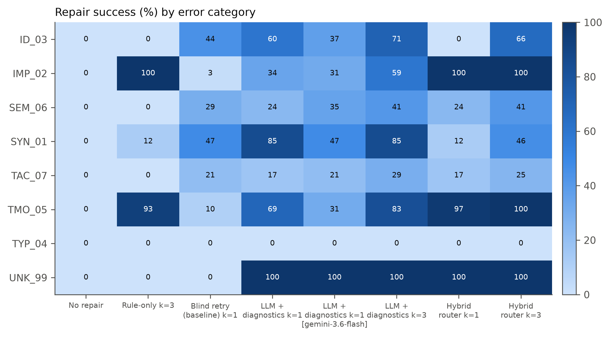
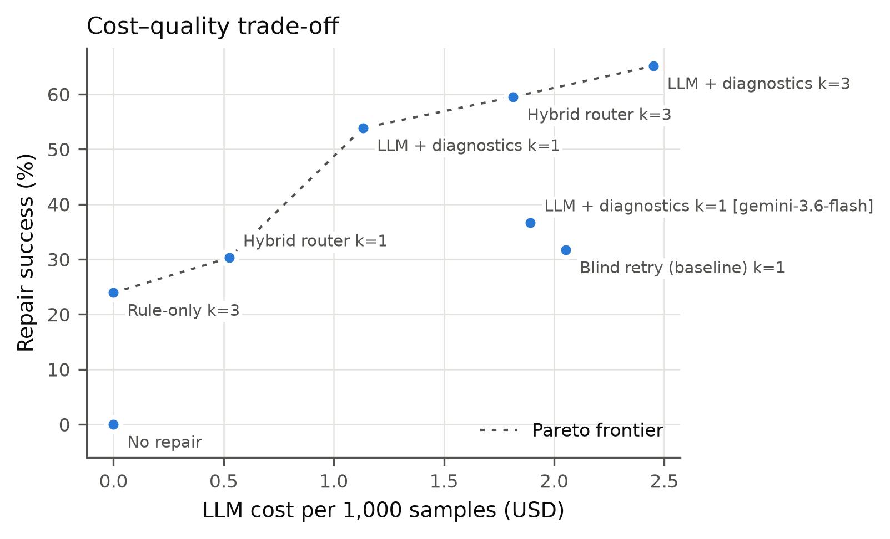
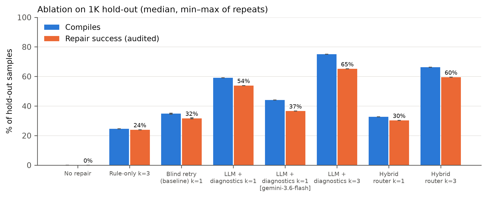
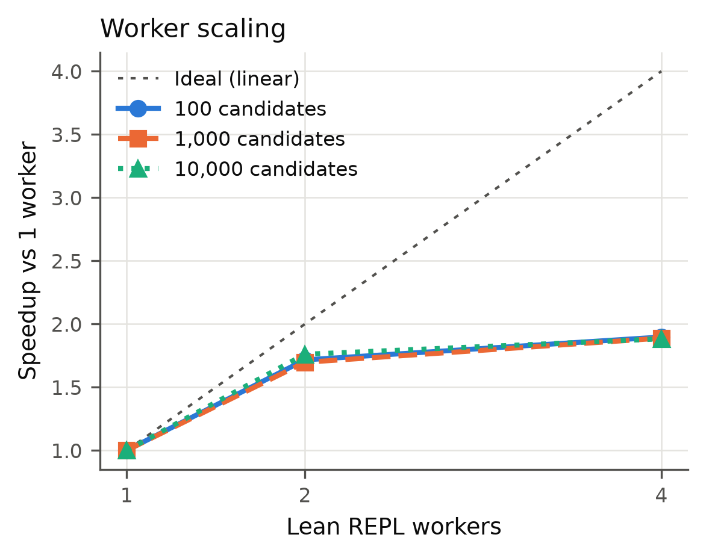
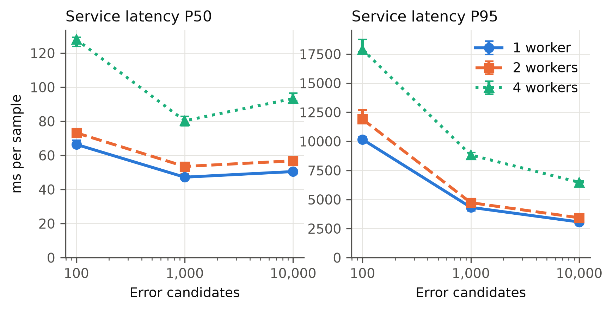

# Tóm tắt

Các pipeline tự động hình thức hoá toán học sinh ra hàng nghìn tới hàng chục nghìn chứng minh Lean 4, phần lớn không biên dịch được. Sửa chúng ở quy mô lớn là một bài toán *dữ liệu lớn*: mỗi lần kiểm chứng nguội phải nạp thư viện Mathlib (~6 GB), hàng đợi lỗi tăng tuyến tính theo quy mô, và việc thử lại bằng mô hình ngôn ngữ (LLM) làm chi phí và độ trễ đuôi tăng nhanh nếu không được giới hạn. Chúng tôi xây dựng hệ thống **Verifier-Guided Repair** gồm: bộ kiểm chứng Lean REPL thường trú chạy trong pool worker; bộ phân tích lỗi với taxonomy 7 nhóm rút ra từ thông báo thật của Lean 4.35; bộ định tuyến sang luật sửa (0 token) hoặc LLM có tiêm chẩn đoán; vòng lặp sửa–kiểm có giới hạn số lần thử, thời gian và ngân sách; và bộ kiểm toán ngữ nghĩa chống "sửa bằng cách đổi đề". Trên tập lỗi v1.0 gồm 17.031 mẫu có nhãn sinh từ Lean (15.921 lỗi tổng hợp từ 3.666 chứng minh đã kiểm chứng và 1.110 lỗi tự nhiên do trôi phiên bản Mathlib), REPL thường trú giảm thời gian kiểm chứng từ 63–107 s/tệp xuống P50 3 ms / P95 23 ms mỗi định lý. Trên tập hold-out, tiêm chẩn đoán có cấu trúc nâng tỷ lệ sửa thành công đã kiểm toán từ **31,7%** (thử lại nguyên prompt) lên **53,9%** đồng thời giảm 45% chi phí token; với ngân sách 3 lần thử đạt **65,1%** ở $2,45/1.000 mẫu. Ở mức 10.000 ứng viên, thông lượng tăng 1,76× với 2 worker nhưng chỉ 1,88× với 4 worker do tranh chấp CPU (P95 thời gian phục vụ tăng từ 3,1 s lên 6,5 s). Toàn bộ thực nghiệm tiêu $2,97 phí API.

**Từ khoá:** Lean 4, Mathlib, sửa chứng minh tự động, LLM, kiểm chứng hình thức, worker pool, độ trễ đuôi, chi phí token.

# 1. Giới thiệu

**Bối cảnh.** Trong chuỗi AI4Math của lớp, Nhóm 5 dịch đề toán sang Lean 4 theo lô; đầu ra của họ là đầu vào của Nhóm 6, và đầu ra của Nhóm 6 (chứng minh đã kiểm chứng kèm nhãn lỗi) phục vụ Nhóm 7 (phân tích tìm kiếm chứng minh) và Nhóm 8 (gia sư toán). Một tỷ lệ lớn ứng viên không biên dịch được: sai cú pháp, thiếu import, tên lemma sai hoặc đã đổi tên, sai kiểu, tactic không đóng được mục tiêu, vượt ngân sách heartbeat. Cách phổ biến là *thử lại nguyên prompt*, bỏ qua thông tin quý nhất có sẵn: thông báo lỗi của chính trình kiểm chứng.

**Vì sao là bài toán Dữ liệu lớn.** Nút thắt không nằm ở một phép toán mà ở *quy mô, lập lịch và chi phí*: (1) kiểm chứng nguội một tệp phải nạp Mathlib, mất 63–107 s và ~3,5 GB RAM; (2) số ứng viên tăng từ 10² lên 10⁴ khiến hàng đợi và độ trễ đuôi tăng; (3) mỗi lần thử lại bằng LLM tốn token và thời gian mạng; (4) mọi lần thử phải được ghi lại để phát lại (replay) và kiểm toán. Đây là bài toán thông lượng–độ trễ–chi phí dưới ràng buộc tài nguyên.

**Câu hỏi nghiên cứu.**

- **RQ1.** Thông báo lỗi có cấu trúc của Lean có cải thiện tỷ lệ sửa thành công so với thử lại nguyên prompt (cùng dữ liệu, ngân sách, phần cứng, seed) không?
- **RQ2.** Chính sách định tuyến/thử lại nào (rule-only, LLM-only, lai; ngân sách k ∈ {0, 1, 3}) tối ưu tỷ lệ sửa thành công dưới ngân sách token và thời gian?
- **RQ3.** Hệ thống mở rộng thế nào theo số ứng viên (100 → 1K → 10K) và số worker (1/2/4) về thông lượng, độ trễ P50/P95 và bộ nhớ?

**Đóng góp.** (1) Bộ dữ liệu lỗi Lean 4 v1.0 có nhãn sinh từ trình kiểm chứng, tập hold-out tách theo định lý gốc (0 rò rỉ); (2) taxonomy lỗi v0.2 đối chiếu với Lean 4.35, thêm nhóm TAC_07; (3) pipeline sửa có giới hạn, có kiểm toán ngữ nghĩa và kiểm soát chi phí cứng; (4) đánh giá đồng thời chất lượng, chi phí, thông lượng, độ trễ và bộ nhớ trên 3 mức quy mô với 3 lần lặp, kèm phân tích nút thắt khởi động nguội và tranh chấp CPU.

# 2. Công trình liên quan

**Môi trường và dữ liệu chứng minh.** LeanDojo [1] cung cấp công cụ tương tác với Lean và cho thấy giá trị của truy hồi premise. Lean Workbook [2] hình thức hoá hàng chục nghìn bài toán thi đấu; ProofNet [3] là benchmark tự hình thức hoá cấp đại học. Chúng tôi dùng bộ chứng minh của Goedel-Prover [4] trên Lean Workbook làm nguồn định lý đúng.

**Sinh và sửa chứng minh bằng LLM.** Baldur [5] sinh toàn bộ chứng minh và sửa bằng cách đưa thông báo lỗi vào mô hình (Isabelle/HOL) — gần nhất với RQ1. Self-Debugging [6] cho thấy LLM tự sửa mã tốt hơn khi có phản hồi thực thi. DeepSeek-Prover-V1.5 [7] dùng phản hồi của Lean cho học tăng cường và tìm kiếm cây; DeepSeek-Prover-V2 [8] phân rã mục tiêu con. Draft-Sketch-Prove [9] dùng bản nháp phi hình thức dẫn hướng chứng minh.

**Khoảng trống.** Các công trình trên tối ưu chất lượng mô hình; ít công trình báo cáo đồng thời chi phí token, độ trễ đuôi và khả năng mở rộng của *hệ thống kiểm chứng* — phần chiếm phần lớn thời gian thực tế. Chúng tôi coi verifier là tài nguyên khan hiếm cần lập lịch, theo tinh thần xử lý theo lô và phân tán trong [10].

# 3. Dữ liệu và thu nhận

**Nguồn và giấy phép.** Định lý gốc lấy từ *Goedel-LM/Lean-workbook-proofs* (giấy phép MIT, 29.750 tệp Lean 4 hoàn chỉnh kèm đề bằng ngôn ngữ tự nhiên trong chú thích). Tệp nguồn được tải bằng `scripts/download_data.sh` có kiểm SHA-256; dữ liệu đầy đủ không đưa vào Git, chỉ mẫu nhỏ và `data_sample/manifest.json` (số dòng, checksum từng tệp).

**Tập định lý gốc (seed).** Lấy ngẫu nhiên có seed 5.000 chứng minh, kiểm chứng lại với Lean 4.35.0 + Mathlib v4.35.0 (giới hạn `maxHeartbeats` = 400.000 thay cho "không giới hạn" của dữ liệu gốc, timeout 30 s). Kết quả: **3.666 seed** (73,3%) biên dịch sạch; **1.110 chứng minh** không còn biên dịch được với Mathlib hiện tại được giữ làm **lỗi tự nhiên** (đổi tên lemma như `le_div_iff` → `le_div_iff₀`, cú pháp `∑ x in s` cũ); 224 vượt thời gian. Thông lượng 1,08 ứng viên/s trên 4 worker; P50 0,57 s, P95 25,8 s — đuôi dài do các chứng minh `nlinarith` nặng.

**Sinh lỗi tổng hợp.** Mỗi seed nhận tối đa 5 trong 9 toán tử gây lỗi (Bảng 1), chọn bằng bộ sinh ngẫu nhiên tất định theo seed. Một đột biến chỉ được giữ nếu Lean *thật sự* báo lỗi (với `sem_sorry`: cảnh báo `sorry`); 2.388/18.309 đột biến bị loại vì không làm hỏng chứng minh (chủ yếu `tac_weaken`, `tmo_low_heartbeats`, `id_tactic_typo`). **Nhãn luôn lấy từ thông báo Lean thật** qua parser.

| Toán tử | Nhóm dự kiến | Cách gây lỗi |
|---|---|---|
| `syn_drop_paren`, `syn_drop_assign` | SYN_01 | xoá một `)` trong phát biểu; xoá `:=` |
| `imp_drop_import` | IMP_02 | xoá toàn bộ dòng `import` |
| `id_lemma_typo`, `id_tactic_typo` | ID_03 | xoá 1 ký tự tên lemma; viết sai tên tactic |
| `typ_change_type` | TYP_04 | đổi kiểu một biến ℝ ↔ ℕ trong phát biểu |
| `tac_weaken` | TAC_07 | thay `nlinarith [...]` bằng `linarith`… |
| `tmo_low_heartbeats` | TMO_05 | hạ `maxHeartbeats` xuống 500 |
| `sem_sorry` | SEM_06 | thay chứng minh bằng `sorry` |

*Bảng 1. Toán tử sinh lỗi.*

**Chia tập và các mức quy mô.** Khử trùng lặp theo SHA-256 (0 trùng). Chia train/hold-out 70/30 **theo seed** (băm `seed_id`): 0/4.776 seed xuất hiện ở cả hai phía. Bốn mức lồng nhau 100 ⊂ 1K ⊂ 10K ⊂ 17.031; hold-out của mức 1K có 284 mẫu (271 tổng hợp, 13 tự nhiên), của mức 10K có 2.907 mẫu.

| Nhóm | SYN_01 | ID_03 | SEM_06 | IMP_02 | TAC_07 | TMO_05 | TYP_04 | UNK_99 |
|---|---|---|---|---|---|---|---|---|
| Số mẫu (17.031) | 4.590 | 3.978 | 2.292 | 2.269 | 1.827 | 1.707 | 338 | 30 |

*Bảng 2. Phân bố nhãn lỗi chính (từ Lean) của dataset v1.0.*

**Chất lượng nhãn.** Nhãn sinh lại từ chẩn đoán lưu trữ khớp 17.031/17.031 (tái lập được). Nhóm dự kiến của toán tử trùng nhãn Lean ở 94,4% mẫu tổng hợp; lệch lớn nhất là `typ_change_type` (776/1.133 thành TAC_07: đổi ℝ→ℕ thường khiến tactic thất bại thay vì lỗi kiểu) — nhãn phản ánh triệu chứng Lean báo, đúng với thứ hệ thống sửa nhìn thấy. Trước đó, tập 50 lỗi viết tay tuần 1 chỉ khớp 15/50 với Lean thật, và 14/50 thậm chí biên dịch được — lý do chuyển sang nhãn sinh từ trình kiểm chứng.

**Hạn chế dữ liệu.** Lỗi tổng hợp có thể khác phân bố lỗi do LLM sinh; bài toán thiên về bất đẳng thức thi đấu; lỗi tự nhiên trong hold-out 1K chỉ 13 mẫu; chưa có dữ liệu thật từ Nhóm 5.

# 4. Phương pháp và kiến trúc

**Tổng quan.** Hàng đợi ứng viên → parser & taxonomy → router → (luật | LLM) → worker Lean REPL → kiểm toán ngữ nghĩa → thành công | thử lại nếu còn ngân sách | lưu thất bại → log phát lại được (sơ đồ chi tiết: `docs/architecture.md`).

**Bộ kiểm chứng REPL thường trú.** Mỗi worker giữ một tiến trình Lean REPL đã nạp Mathlib một lần (môi trường gốc) và một môi trường lõi rỗng; mỗi ứng viên được kiểm trong môi trường gốc nên các lần kiểm cô lập với nhau. Dòng `import` được kiểm tra tồn tại trong bản build (để lỗi IMP_02 vẫn quan sát được) rồi bỏ đi; mã không import chạy trong môi trường lõi. Kết quả khớp 74/74 lần với Lean chạy nguội từng tệp. Khi một tactic chạy quá thời gian hoặc REPL chết, cả nhóm tiến trình (lệnh `lake` và tiến trình `repl` con) bị huỷ rồi khởi động lại; kết quả lần kiểm hỏng được đánh dấu `CRASH` và không bao giờ dùng để gán nhãn.

**Taxonomy và parser.** 7 nhóm (Bảng 3), so khớp theo thứ tự ưu tiên trên văn bản thông báo thật; IMP_02 còn được suy ra từ ngữ cảnh (mã không import nhưng dùng ℝ, `nlinarith`…). Lỗi chính là lỗi có vị trí sớm nhất *sau khi loại các lỗi hệ quả*: `unsolved goals` được Lean báo ở dòng khai báo (sớm hơn) nhưng là hệ quả của tactic hỏng bên dưới, nên chỉ được chọn khi không còn lỗi nào khác — sửa điều này nâng độ khớp nhãn từ 85,1% lên 95,0%.

| Mã | Nhóm | Định tuyến |
|---|---|---|
| SYN_01 | cú pháp | luật |
| IMP_02 | thiếu import | luật |
| ID_03 | định danh không tồn tại / đổi tên | lai |
| TYP_04 | sai kiểu, thiếu instance | LLM |
| TMO_05 | vượt heartbeat | điều khiển hệ thống |
| SEM_06 | `sorry` / đổi đề | kiểm toán |
| TAC_07 | tactic không đóng mục tiêu | LLM |

*Bảng 3. Taxonomy v0.2.*

**Luật sửa (0 token).** R0 khôi phục `import Mathlib`; R1–R2 ngoặc/từ khoá; R3 bảng import; R4 bí danh định danh; R5 bảng đổi tên Mathlib (đã kiểm tra tồn tại trong mã nguồn v4.35.0); R6 cú pháp toán tử lớn; R7 khôi phục ngân sách heartbeat.

**Sửa bằng LLM.** Hai chế độ dùng chung system prompt (cấm `sorry`/`axiom`, giữ nguyên phát biểu): *blind* — chỉ đưa tệp lỗi (baseline theo đề bài: thử lại nguyên prompt, không phân loại, không thông báo Lean); *diagnostic* — mã đánh số dòng và tối đa 5 thông báo lỗi kèm nhãn taxonomy. Trước khi gửi, chú thích được thay bằng khoảng trắng (giữ nguyên dòng và cột vì Lean nhạy thụt lề và chẩn đoán dùng toạ độ dòng:cột), giảm 66% ký tự; 500/500 seed đã bỏ chú thích vẫn biên dịch. Áp dụng như nhau cho mọi chiến lược. Mô hình: Gemini 3.5 Flash-Lite, nhiệt độ 0, seed 42, `thinking_level=minimal`.

**Vòng lặp có giới hạn.** Với mỗi mẫu: tối đa *k* lần thử, ngân sách 300 s; mỗi ứng viên được kiểm chứng và kiểm toán; dừng khi thành công, hết ngân sách, không có luật áp dụng (rule-only) hoặc **ứng viên lặp lại** (so SHA-256) — đảm bảo không lặp vô hạn. Mỗi lần thử ghi một sự kiện (engine, luật, nhãn, trạng thái Lean, lý do kiểm toán, token, độ trễ, mã ứng viên) vào log nén để phát lại.

**Kiểm toán ngữ nghĩa.** Thành công ⇔ Lean biên dịch, không `sorry`, không cấu trúc cấm (`sorry`, `admit`, `axiom`, `native_decide`, `implemented_by`, `unsafe`) ngoài chú thích, và phát biểu định lý trùng bản gốc sau chuẩn hoá khoảng trắng. Kiểm tra dạng văn bản là bảo thủ: có thể đếm thiếu, không đếm thừa.

**Lập lịch và kiểm soát chi phí.** Pool luồng, mỗi worker sở hữu một REPL; hàng đợi FIFO; đo riêng thời gian chờ và thời gian phục vụ. Trước mỗi lần gọi LLM trả phí, chi phí xấu nhất được kiểm với trần tháng ($8) và trần lần chạy ($2–3): vượt trần → từ chối trước khi gọi. Sổ chi tiêu ghi mỗi lần gọi; bộ đệm câu trả lời (khoá = băm toàn bộ yêu cầu) giúp các lần lặp không tốn phí.

**Độ phức tạp.** Với *N* ứng viên, *W* worker, *k̄* lần thử trung bình, thời gian kiểm chứng *v*, độ trễ LLM *ℓ* và tỷ lệ lần thử đi qua LLM *p*: thời gian ≈ *T₀* + *N·k̄·(v + p·ℓ)/W*, với *T₀* là thời gian nạp Mathlib song song (một lần, 11–25 s/worker trên Kaggle). Bộ nhớ tăng gần tuyến tính theo *W* (12,6 → 21,1 GB USS từ 1 lên 4 worker) — giới hạn số worker trên một máy.

# 5. Thiết lập thực nghiệm

**Phần cứng.** Kaggle CPU notebook: Linux x86_64, 4 vCPU, 31,3 GB RAM. Máy phát triển (Apple M1, 16 GB) chỉ dùng cho phát triển và kiểm thử đơn vị: tại đây kiểm chứng nguội mất 63–107 s/tệp và hai worker REPL đẩy swap lên hơn 14 GB.

**Phần mềm.** Lean 4.35.0, Mathlib v4.35.0, Lean REPL v4.35.0 (ghim trong `lean_ws/lake-manifest.json`); Python 3.13 (Kaggle); phiên bản gói ghi trong từng run record và `requirements-lock.txt`.

**Chiến lược.** `none` (sàn), `rule_only`, `blind` (baseline bắt buộc), `llm_only` (có chẩn đoán), `hybrid` (router: lỗi định tuyến luật thử luật trước, còn lại LLM). Mọi chiến lược dùng **cùng tập hold-out, timeout Lean 60 s, phần cứng, seed 42**.

| Nhóm | Dữ liệu | Cấu hình | Lặp |
|---|---|---|---|
| RQ1 | hold-out mức 1K (n=284) | blind k=1 vs llm_only k=1 | 3 |
| RQ2 | hold-out mức 1K | none; rule_only k=3; llm_only k=3; hybrid k∈{1,3} | 2–3 |
| RQ2 – mô hình | hold-out mức 1K | llm_only k=1, Gemini 3.6 Flash | 1 |
| RQ2 – quy mô | hold-out mức 10K (n=2.907) | hybrid k=1 | 1 |
| RQ3 (chỉ Lean, $0) | 100 / 1K / 10K | rule_only k=1 × 1/2/4 worker | 3 |

*Bảng 4. Ma trận thí nghiệm. Lần lặp 2–3 của cấu hình LLM dùng bộ đệm câu trả lời.*

**Chỉ số.** *Chính:* tỷ lệ sửa thành công đã kiểm toán (RQ1/RQ2) và thông lượng ổn định (RQ3). *Phụ:* tỷ lệ biên dịch, số lần thử/mẫu, token/thành công, chi phí USD theo token (định giá mọi lần gọi kể cả lấy từ bộ đệm, để so sánh công bằng giữa cấu hình), thời gian phục vụ P50/P95, thời gian chờ P95, bộ nhớ đỉnh USS. Thông lượng ổn định loại trừ thời gian nạp Mathlib của worker. Kết quả lặp báo cáo **trung vị [min–max]**. Giá: Flash-Lite $0,30/$2,50 và Flash 3.6 $0,75/$3,75 mỗi triệu token vào/ra.

**Tái lập.** Mỗi lần chạy ghi `results/raw/run_<run_id>.json` (commit, phiên bản dữ liệu kèm checksum, máy, phần mềm, tham số, seed, timeout, chỉ số, trạng thái) và log từng mẫu `results/raw/logs/<run_id>.jsonl.gz`. Hình và bảng sinh bằng `scripts/generate_figures.py` và `scripts/analyze_failures.py`. Lệnh tái lập: Phụ lục C.

# 6. Kết quả

## 6.1. Chi phí kiểm chứng: khởi động nguội là nút thắt đầu tiên

| Cách kiểm chứng | Thời gian / định lý | Bộ nhớ |
|---|---|---|
| `lake env lean` mỗi tệp (nguội, M1 16 GB) | 63–107 s | ~3,5 GB mỗi lần |
| REPL thường trú (M1, sau khi nạp Mathlib ~107 s) | P50 3 ms · P95 23 ms | ~3,5 GB / worker |
| REPL thường trú (Kaggle, nạp Mathlib 11–25 s/worker) | sinh dữ liệu: P50 70 ms · P95 2,1 s | — |

*Bảng 5. Gần như toàn bộ chi phí nằm ở khởi động; tái sử dụng worker giảm 3–4 bậc độ lớn.*

## 6.2. RQ1 — Thông báo lỗi có cấu trúc

| Chiến lược (k=1) | Thành công | Biên dịch | Token vào/ra mỗi lần gọi | $/1.000 mẫu |
|---|---|---|---|---|
| Blind retry (baseline) | **31,7%** [31,3–32,0] | 34,9% | 319 / 783 | 2,05 |
| LLM + chẩn đoán | **53,9%** [53,9–53,9] | 59,2% | 535 / 389 | 1,13 |

*Bảng 6. 1K hold-out, n=284, 3 lần lặp, Gemini 3.5 Flash-Lite.*

Tiêm chẩn đoán tăng **22,2 điểm %** tỷ lệ thành công đã kiểm toán và **giảm 45% chi phí**: dù prompt dài hơn 68%, câu trả lời ngắn hơn một nửa — mô hình sửa cục bộ thay vì viết lại toàn bộ tệp. Lợi ích lớn nhất ở lỗi có thông báo đặc hiệu: SYN_01 47% → 85%, TMO_05 10% → 69%, IMP_02 3% → 34% (Hình 1).



## 6.3. RQ2 — Định tuyến, ngân sách thử lại và mô hình

| Chiến lược | k | Thành công | Biên dịch | Lần thử/mẫu | $/1.000 mẫu | P95 phục vụ |
|---|---|---|---|---|---|---|
| Không sửa | 0 | 0,0% | 0,0% | 0 | 0 | — |
| Rule-only | 3 | 23,9% | 24,6% | 0,82 | 0 | 6,4 s |
| Hybrid | 1 | 30,3% | 32,8% | 1,00 | 0,53 | 9,4 s |
| LLM + chẩn đoán | 1 | 53,9% | 59,2% | 1,00 | 1,13 | 16,4 s |
| Hybrid | 3 | 59,5% | 66,2% | 2,14 | 1,81 | 23,3 s |
| **LLM + chẩn đoán** | **3** | **65,1%** | **75,0%** | 1,82 | 2,45 | 19,3 s |
| LLM + chẩn đoán, Gemini 3.6 Flash | 1 | 36,6% | 44,0% | 1,00 | 1,89 | 18,9 s |
| Hybrid, hold-out 10K (n=2.907) | 1 | 34,1% | 37,5% | 1,00 | 0,34 | 7,7 s |

*Bảng 7. Ablation trên 1K hold-out (trung vị của 2–3 lần lặp; spread ≤ 0,7 điểm %).*





Biên Pareto chi phí–chất lượng (Hình 2) gồm rule-only ($0; 23,9%) → hybrid k=1 ($0,53; 30,3%) → LLM k=1 ($1,13; 53,9%) → hybrid k=3 ($1,81; 59,5%) → LLM k=3 ($2,45; 65,1%). Ba quan sát: (i) **ngân sách 3 lần thử** (Hình 3) thêm 11,2 điểm % với chi phí ×2,2; 82,7% thành công đến ngay lần thử đầu, 12,4% ở lần 2 và 4,9% ở lần 3 — lợi ích giảm dần; (ii) **hybrid kém LLM thuần ở cùng k** vì luật được thử trước trên 203/284 mẫu nhưng chỉ đúng 33% (§7.2), khi luật sai và k=1 thì không còn lượt cho LLM; (iii) **mô hình lớn hơn không tốt hơn** dưới cùng cấu hình: Gemini 3.6 Flash đạt 36,6%, nhiều lỗi biên dịch hơn và tự ý đổi phát biểu nhiều hơn (§7.3).

## 6.4. RQ3 — Khả năng mở rộng

| Mức | Worker | Thông lượng (mẫu/s) | Tăng tốc | P50 phục vụ | P95 phục vụ | USS đỉnh |
|---|---|---|---|---|---|---|
| 100 | 1 / 2 / 4 | 0,95 / 1,62 / 1,79 | 1,00 / 1,72 / 1,90 | 66 / 73 / 128 ms | 10,2 / 11,9 / 17,9 s | 8,6 / 8,8 / 12,8 GB |
| 1K | 1 / 2 / 4 | 1,32 / 2,24 / 2,49 | 1,00 / 1,70 / 1,89 | 47 / 54 / 80 ms | 4,3 / 4,7 / 8,8 s | 9,2 / 16,1 / 16,3 GB |
| 10K | 1 / 2 / 4 | 1,52 / 2,68 / 2,86 | 1,00 / 1,76 / 1,88 | 51 / 57 / 93 ms | 3,1 / 3,4 / 6,5 s | 12,6 / 15,5 / 21,1 GB |

*Bảng 8. rule_only k=1, toàn bộ mức, 3 lần lặp (spread thông lượng ≤ 4%). Tỷ lệ thành công không đổi theo số worker (26,1% ở 10K).*

Tăng từ 1 lên 2 worker gần tuyến tính (1,70–1,76×), nhưng từ 2 lên 4 chỉ thêm 7–11%, trong khi P95 thời gian phục vụ tăng gấp đôi và P50 tăng ~65% (Hình 4–5): 4 tiến trình REPL tranh 4 vCPU với tiến trình điều phối và các tactic nặng — **hệ thống bị giới hạn bởi CPU** ở 2 worker/4 vCPU. Bộ nhớ tăng theo số worker; đếm RSS cộng trùng phần Mathlib ánh xạ chung (tới 35 GB trên máy 31 GB), nên chúng tôi báo cáo USS. P95 ở mức 100 cao hơn vì với 100 mẫu, P95 chỉ do ~5 mẫu nặng nhất quyết định. Thời gian chờ hàng đợi trong chế độ chạy lô tăng tuyến tính theo *N* (mọi mẫu vào hàng đợi cùng lúc) nên không dùng làm chỉ số so sánh giữa các mức.





# 7. Phân tích lỗi, ablation và mối đe doạ tính hợp lệ

## 7.1. Vì sao vòng lặp dừng và vì sao bản sửa bị loại

| Cấu hình | Thành công | Hết ngân sách | Không có luật | Ứng viên lặp |
|---|---|---|---|---|
| Blind k=1 | 32,0% | 68,0% | — | — |
| LLM k=1 | 53,9% | 46,1% | — | — |
| LLM k=3 | 65,1% | 30,3% | — | 4,6% |
| Hybrid k=3 | 59,5% | 38,7% | — | 1,8% |
| Rule-only k=3 | 23,9% | — | 76,1% | — |

*Bảng 9. Lý do dừng (lần lặp 1). Cơ chế khử trùng lặp cắt 4,6% mẫu khỏi các lần thử vô ích.*

Trong các mẫu thất bại, lần thử cuối bị loại chủ yếu vì không biên dịch (77–99%). Đáng chú ý: **16,8–26,3% bản sửa của LLM tự ý đổi phát biểu** và 10–24% chèn `sorry` hoặc cấu trúc cấm — các trường hợp này *biên dịch được* hoặc trông như hợp lệ, và chỉ bị chặn nhờ kiểm toán ngữ nghĩa. Không có kiểm toán, tỷ lệ "thành công" sẽ bị thổi phồng (ví dụ LLM k=3: biên dịch 75,0% so với thành công thật 65,1%).

## 7.2. Độ chính xác từng luật

| Luật | Số lần áp dụng | Qua kiểm toán | Độ chính xác |
|---|---|---|---|
| R3 bảng import | 253 | 0 | 0% |
| R2 chèn từ khoá | 126 | 0 | 0% |
| R0 khôi phục `import Mathlib` | 99 | 96 | **97%** |
| R1 cân bằng ngoặc | 99 | 27 | 27% |
| R7 ngân sách heartbeat | 81 | 81 | **100%** |
| R5 đổi tên Mathlib | 15 | 0 | 0% |
| R4 bí danh định danh | 10 | 0 | 0% |
| R6 cú pháp toán tử lớn | 9 | 0 | 0% |

*Bảng 10. Gộp rule-only và hybrid trên 1K hold-out.*

Các luật viết cho đoạn mã ngắn ở tuần 4 (R1–R4) không chuyển được sang tệp hoàn chỉnh: R2 chèn từ khoá `theorem` làm mất định lý, R3 thêm import sai module, R1 nối ngoặc vào cuối tệp. Luật thiết kế từ lỗi thật (R0, R7) gần như hoàn hảo. R5 (đổi tên) 0% vì lỗi tự nhiên thường có nhiều lỗi đan xen, đổi tên một lemma chưa đủ. Hệ quả cho thiết kế: router chỉ nên gửi sang luật có độ chính xác cao, đo trên tập **train** (không trên hold-out) — hướng cải tiến trực tiếp cho hybrid.

## 7.3. Theo nhóm lỗi, nguồn lỗi và mô hình

LLM k=3 sửa tốt SYN_01 (85%), TMO_05 (83%), ID_03 (71%) nhưng kém ở TAC_07 (29%) và SEM_06 (41%) — hai nhóm đòi hỏi *viết chứng minh mới* chứ không chỉ sửa chỗ hỏng (Hình 1). Lỗi tự nhiên khó hơn rõ rệt: LLM k=1 đạt 7,7% (n=13) so với 56,1% trên lỗi tổng hợp; với k=3 là 30,8% so với 66,8%. Gemini 3.6 Flash thua Flash-Lite chủ yếu vì nhiều lỗi biên dịch hơn (125 so với 76 mẫu) và đổi phát biểu thường hơn; cả hai chạy với `thinking_level=minimal`, mức này có thể bất lợi cho mô hình lớn — chúng tôi không kết luận "mô hình lớn kém hơn".

## 7.4. Mối đe doạ tính hợp lệ

- *Dữ liệu tổng hợp:* đột biến có thể dễ/khó khác lỗi thật; giảm thiểu bằng lỗi tự nhiên (báo cáo tách) nhưng hold-out chỉ có 13 mẫu tự nhiên.
- *Kiểm toán văn bản:* phát biểu tương đương viết khác bị tính là đổi đề → đếm thiếu thành công.
- *Bộ đệm LLM:* lần lặp 2–3 phản ánh tính tất định ở nhiệt độ 0 chứ không phản ánh biến thiên độ trễ API; các cấu hình chạy sau (hybrid) dùng lại câu trả lời trùng prompt của cấu hình trước, nên chi phí so sánh dùng định giá theo token, không theo chi tiêu thật.
- *Phần cứng chia sẻ:* Kaggle là máy ảo dùng chung; thông lượng rule-only lệch 2,4 vs 4,0 mẫu/s giữa hai phiên khác nhau. Giảm thiểu: mọi cấu hình của một mức chạy trong cùng phiên, xen kẽ lần lặp, báo cáo min–max.
- *Một họ mô hình, một cấu hình suy nghĩ:* kết luận về LLM giới hạn ở Gemini Flash với `thinking_level=minimal`.
- *Rò rỉ:* chia theo seed; luật R0, R5–R7 được thiết kế từ lỗi quan sát trên tập 50 mẫu cũ và seed thử nghiệm, không từ hold-out.
- *Ghi chú provenance:* các run có gọi LLM ghi commit với hậu tố `-dirty` do sổ chi tiêu (tệp được theo dõi) được ghi thêm trong lúc chạy; mã nguồn không đổi (đã sửa cách tính ở bản sau).

# 8. Kết luận và hướng phát triển

Trả lời ba câu hỏi nghiên cứu: **(RQ1)** tiêm chẩn đoán có cấu trúc của Lean tăng tỷ lệ sửa thành công đã kiểm toán từ 31,7% lên 53,9% và giảm 45% chi phí so với thử lại nguyên prompt; **(RQ2)** ngân sách 3 lần thử với LLM có chẩn đoán đạt 65,1% ở $2,45/1.000 mẫu, là điểm chất lượng cao nhất trên biên Pareto; hybrid chỉ có lợi về chi phí và bị kéo xuống bởi các luật độ chính xác thấp; **(RQ3)** nút thắt đầu tiên là khởi động nguội Mathlib (giải bằng REPL thường trú, nhanh hơn 3–4 bậc độ lớn), nút thắt thứ hai là CPU: thông lượng bão hoà ở khoảng 2 worker trên 4 vCPU. Kiểm toán ngữ nghĩa là bắt buộc: 17–26% bản sửa của LLM đổi đề hoặc lách bằng `sorry`.

**Hướng phát triển:** (1) router chọn luật theo độ chính xác đo trên tập train; (2) hàng đợi ưu tiên (lỗi rẻ và luật chính xác trước); (3) phân tán worker qua nhiều máy (Redis/RabbitMQ) vì một máy bão hoà CPU sớm; (4) kiểm toán bằng so sánh kiểu đã elaborate thay cho văn bản; (5) dữ liệu thật của Nhóm 5 và mô hình chuyên Lean mã nguồn mở (DeepSeek-Prover-V2) chạy cục bộ trên GPU.

# Tài liệu tham khảo

[1] K. Yang et al., "LeanDojo: Theorem Proving with Retrieval-Augmented Language Models," NeurIPS Datasets and Benchmarks, 2023.
[2] H. Ying et al., "Lean Workbook: A large-scale Lean problem set formalized from natural language math problems," NeurIPS Datasets and Benchmarks, 2024.
[3] Z. Azerbayev et al., "ProofNet: Autoformalizing and Formally Proving Undergraduate-Level Mathematics," arXiv:2302.12433, 2023.
[4] Y. Lin et al., "Goedel-Prover: A Frontier Model for Open-Source Automated Theorem Proving," arXiv:2502.07640, 2025.
[5] E. First, M. Rabe, T. Ringer, Y. Brun, "Baldur: Whole-Proof Generation and Repair with Large Language Models," ESEC/FSE, 2023.
[6] X. Chen, M. Lin, N. Schärli, D. Zhou, "Teaching Large Language Models to Self-Debug," ICLR, 2024.
[7] H. Xin et al., "DeepSeek-Prover-V1.5: Harnessing Proof Assistant Feedback for Reinforcement Learning and Monte-Carlo Tree Search," arXiv:2408.08152, 2024.
[8] Z. Z. Ren et al., "DeepSeek-Prover-V2: Advancing Formal Mathematical Reasoning via Reinforcement Learning for Subgoal Decomposition," arXiv:2504.21801, 2025.
[9] A. Q. Jiang et al., "Draft, Sketch, and Prove: Guiding Formal Theorem Provers with Informal Proofs," ICLR, 2023.
[10] J. Leskovec, A. Rajaraman, J. D. Ullman, *Mining of Massive Datasets*, Cambridge University Press.

# Phụ lục A. Tuyên bố sử dụng AI

Nhóm sử dụng trợ lý AI (Claude, Anthropic) cho sinh và sửa mã, thiết kế thực nghiệm, phân tích và soạn tài liệu; Gemini 3.5 Flash-Lite / 3.6 Flash là *đối tượng nghiên cứu* (bộ sửa lỗi), không phải công cụ viết báo cáo. Mọi mã do AI hỗ trợ được kiểm chứng bằng 96 kiểm thử tự động và chạy Lean thật; mọi số liệu trong báo cáo truy được tới run record trong `results/raw/`. Nhật ký định lượng từng lần sử dụng: `docs/ai_use_log.jsonl`, tổng hợp: `docs/ai_use_statement.md`.

# Phụ lục B. Phân công và đóng góp

Xem `contributions.md`: phân vai theo Hướng dẫn BTL, đóng góp đối chiếu lịch sử Git, phần bảo vệ của từng thành viên.

# Phụ lục C. Lệnh tái lập

```bash
git clone -b feat/verifier-guided-pipeline https://github.com/tamdv/ai4math-verifier-guided-repair.git
cd ai4math-verifier-guided-repair
bash scripts/kaggle_setup.sh                       # Lean 4.35 + Mathlib + REPL, deps, data, tests
python scripts/build_seeds.py --n 5000 --workers 4 --timeout 30
python scripts/generate_error_dataset.py --workers 4 --max-per-seed 5 --timeout 30
python scripts/run_experiment.py --data data/errors/errors_1k.jsonl --split holdout \
    --strategy llm_only --budget 3 --workers 4      # ma trận đầy đủ: notebooks/sessions/*.ipynb
python scripts/generate_figures.py --input results/raw/ --output results/figures/
python scripts/analyze_failures.py --input results/raw/ --output results/figures/
python scripts/demo_repair.py --replay results/raw/logs/exp-llm_only-b3-w4-20261017101714-3f7a7e.jsonl.gz \
    --pick success --data data/errors/errors_1k.jsonl
```
